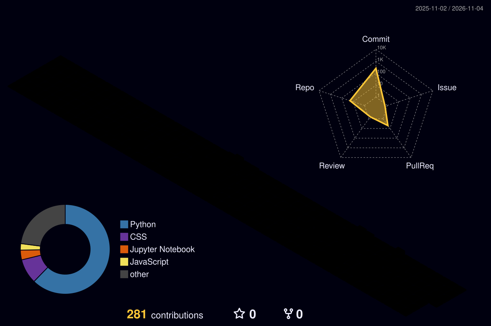

@@ -1,340 +1,384 @@

    

  
  

  
  

  
  

<h3 align="center"> 💻 Developer From Bengaluru, India</h3>  

  

<h3 align="center">💻 Developer From Bengaluru, India</h3>

<table width="100%">
  <tr>
    <td align="left">
      
    </td>
    <td align="right">
      
    </td>
  </tr>
</table>

**Connect with me:**

  
  &nbsp;&nbsp;&nbsp;&nbsp;&nbsp;&nbsp;&nbsp;&nbsp;&nbsp;&nbsp;&nbsp;&nbsp;&nbsp;&nbsp;&nbsp;&nbsp;&nbsp;&nbsp;&nbsp;&nbsp;&nbsp;&nbsp;&nbsp;&nbsp;&nbsp;&nbsp;&nbsp;&nbsp;&nbsp;&nbsp;&nbsp;&nbsp;&nbsp;&nbsp;&nbsp;&nbsp;&nbsp;&nbsp;&nbsp;&nbsp;&nbsp;&nbsp;&nbsp;&nbsp;&nbsp;&nbsp;&nbsp;&nbsp;&nbsp;&nbsp;&nbsp;&nbsp;&nbsp;&nbsp;&nbsp;&nbsp;&nbsp;&nbsp;&nbsp;&nbsp;&nbsp;&nbsp;&nbsp;&nbsp;&nbsp;&nbsp;&nbsp;&nbsp;&nbsp;&nbsp;&nbsp;&nbsp;&nbsp;&nbsp;&nbsp;&nbsp;&nbsp;&nbsp;&nbsp;&nbsp;&nbsp;&nbsp;&nbsp;&nbsp;&nbsp;&nbsp;&nbsp;&nbsp;&nbsp;&nbsp;&nbsp;&nbsp;&nbsp;&nbsp;&nbsp;&nbsp;&nbsp;&nbsp;&nbsp;&nbsp;&nbsp;&nbsp;&nbsp;&nbsp;&nbsp;&nbsp;&nbsp;&nbsp;&nbsp;&nbsp;&nbsp;&nbsp;&nbsp;&nbsp;&nbsp;&nbsp;&nbsp;&nbsp;&nbsp;&nbsp;&nbsp;&nbsp;&nbsp;&nbsp;&nbsp;&nbsp;&nbsp;&nbsp;&nbsp;&nbsp;&nbsp;&nbsp;&nbsp;&nbsp;&nbsp;&nbsp;&nbsp;&nbsp;&nbsp;&nbsp;&nbsp;&nbsp;&nbsp;&nbsp;&nbsp;&nbsp;&nbsp;&nbsp;&nbsp;&nbsp;&nbsp;&nbsp;&nbsp;&nbsp;&nbsp;&nbsp;
  
  
  
  

  <b>Connect with me:</b>&nbsp;&nbsp;&nbsp;
# Nandini Singh

  &nbsp;&nbsp;&nbsp;
## About Me

  &nbsp;&nbsp;&nbsp;

  
- Pursuing **Master of Computer Applications (MCA)** at **CHRIST (Deemed to be University), Bengaluru**.
- Former **Salesforce Developer Intern** at Arka Inventory.
- Former **AI/ML Intern** at White and Box.
- Passionate about building intelligent applications and solving real-world problems through technology.

**I'm currently working on:**

Enhancing my skills in Machine Learning, Cloud Computing, and Full-Stack Development while building innovative applications.

**I'm looking to collaborate on:**

Full-stack applications, AI-powered tools, data analysis projects, and open-source contributions.

**I'm currently learning:**

Advanced Machine Learning, Cloud Technologies (AWS), Data Structures and Algorithms, and modern web frameworks.

**Ask me about:**

#   Nandini Singh
Python, Java, Salesforce, Web Development, Machine Learning, NLP-based applications, and backend development.

##  About Me:

**Fun fact:**

-  Pursuing **Master of Computer Applications (MCA)** at **Christ University, Bengaluru**
-  Former **Salesforce Developer Intern** at Arka Inventory
-  Passionate about building web applications that solve real-world problems
  
 **I'm currently working on:** Enhancing my skills in Machine Learning, Cloud Computing, and Full-Stack Development while building innovative projects at Christ University.   **I'm looking to collaborate on:** Full-stack web applications, ML-powered tools, data analysis projects, and open-source contributions that create real impact.   **I'm currently learning:** Advanced Machine Learning, Cloud Technologies (AWS), Data Structures & Algorithms, and modern web frameworks.   **Ask me about:** Python, Java, Salesforce, Web Development, Machine Learning, NLP-based applications, or building end-to-end projects.   **Fun fact:** I've been an emcee for numerous events at Christ University — I can code *and* command a stage! 🎤  
I've been an emcee for numerous events at CHRIST University — I can code *and* command a stage!

 

---

##  My favorite tools and technologies

## My Favorite Tools and Technologies

<table align="center">
  <tr>
    <td align="center" width="96">
      
       Python
      
       Python
    </td>
    <td align="center" width="96">
        
       Java
      
       Java
    </td>
    <td align="center" width="96">
        
       JavaScript
      
       JavaScript
    </td>
    <td align="center" width="96">
        
       MySQL
      
       MySQL
    </td>
    <td align="center" width="96">
        
       React
      
       React
    </td>
    <td align="center" width="96">
        
       Docker
      
       Docker
    </td>
    <td align="center" width="96">
        
       C
      
       C
    </td>
  </tr>
  <tr>
    <td align="center" width="96">
        
       Kotlin
      
       Kotlin
    </td>
    <td align="center" width="96">
      
       PHP
    </td>
    <td align="center" width="96">
        
       PHP
      
       HTML5
    </td>
    <td align="center" width="96">
        
       HTML5
      
       CSS
    </td>
    <td align="center" width="96">
        
       CSS
      
       MongoDB
    </td>
    <td align="center" width="96">
        
       MongoDB
      
       GitHub
    </td>
<td align="center" width="96">
  
   GitHub
</td>
    <td align="center" width="96"> 
        
       Git
    <td align="center" width="96">
      
       Git
    </td>
  </tr>
  <tr>
    <td align="center" width="96">
        
       FastAPI
      
       FastAPI
    </td>
    <td align="center" width="96">
        
       Android Studio
      
       Android Studio
    </td>
    <td align="center" width="96">
        
       Figma
      
       Figma
    </td>
    <td align="center" width="96">
        
       Linux
      
       Linux
    </td>
    <td align="center" width="96">
        
       VS Code
      
       VS Code
    </td>
    <td align="center" width="96">
        
       Postman
      
       Postman
    </td>
    <td align="center" width="96">
        
       AWS
      
       AWS
    </td>
  </tr>
</table>
  

---

##  Academic Projects
## Academic Projects

<table>
  <tr>
    <td width="50%">
      <h3 align="center"> DYSAID — Dyslexia Screening Web App</h3>
      <h3 align="center">DYSAID — Dyslexia Screening Web App</h3>
      

        Machine Learning web app using Decision Tree algorithm to identify risk of dyslexia in children below 12. Features data preprocessing, important feature selection, and model evaluation with a Streamlit interface for early, non-invasive screening.
        Machine Learning web application using a Decision Tree algorithm to assess dyslexia risk in children below 12. Uses 12 behavioural reading indicators, data preprocessing, feature selection, and model evaluation. Includes a Streamlit interface, Flask landing page, and MongoDB-backed contact forms.
      

      

        
        
        
        
        
        
      

    </td>
    <td width="50%">
      <h3 align="center"> NutriLens — Nutrition Label Analyzer</h3>
      <h3 align="center">NutriLens — Nutrition Label Analyzer</h3>
      

        Full-stack web application using OCR (Tesseract + OCR.space) to scan food packaging and extract nutritional data. Features NLP-based parsing, Random Forest ML model for health scoring, and a rule-based engine for verifying marketing claims.
        <b>Government of India Copyright Registered</b> 
        Full-stack food packaging claim verification system using OCR (Tesseract and OCR.space) to extract nutritional information. Features NLP-based parsing, a Random Forest model for health scoring, and an FSSAI-aligned rule-based engine for verifying marketing claims.
      

      

        
        
        
        
        
      

    </td>
  </tr>  

<tr>
  <td colspan="2" width="100%">
    <h3 align="center">
      <a href="https://github.com/eersay/MAGE" target="_blank">
        MAGE — Multi-Agent EDA System
      </a>
    </h3>
    

      A multi-agent, goal-conditioned exploratory data analysis
      system that accepts datasets in CSV, Excel, and JSON formats
      and normalizes them into a unified schema. Features
      ReAct-based orchestration across eight modules and
      RAG-grounded recommendations retrieved from a ChromaDB
      vector store. Includes a PostgreSQL-backed data layer,
      role-adaptive outputs, and JWT-secured, rate-limited APIs.
    

    

      
      
      
      
      
    

    

      
    

  </td>
</tr>
  </tr>
  <tr>
    <td colspan="2" width="100%">
      <h3 align="center">
        <a href="https://github.com/eersay/MAGE">
          MAGE — Multi-Agent EDA System
        </a>
      </h3>
      

        A multi-agent, goal-conditioned exploratory data analysis system that accepts user-uploaded datasets in CSV, Excel, and JSON formats and normalizes them into a unified schema. Features ReAct-based orchestration across eight modules and RAG-grounded recommendations retrieved from a ChromaDB vector store. Includes a PostgreSQL-backed data layer, role-adaptive output generation, and JWT-secured, rate-limited API endpoints.
      

      

        
        
        
        
        
      

      

        
      

    </td>
  </tr>
</table>

---

##  Research
## Research

-  **Unveiling Sentiment Trends:** An Approach to Utilize Machine Learning in Studying User Activities on New Social Applications — Research paper using decision tree algorithms for sentiment analysis across various datasets.
- **Unveiling Sentiment Trends: An Approach to Utilize Machine Learning in Studying User Activities on New Social Applications** — Published research paper using Decision Tree algorithms for sentiment analysis across multiple datasets. *(Springer Nature, 2024)*

---

##  GitHub Stats:
## GitHub Stats

  

  

  

  

  

 

  

---

##  GitHub Trophies

## GitHub Trophies

  

 

  

---

###  Random Dev Quote

## Random Dev Quote

  

---

## 3D Contributions

  

---

##  Certifications & Badges
## Certifications & Badges

<!-- CREDLY_BADGES_START -->

  

  

<!-- CREDLY_BADGES_END -->

###  Other Certifications
### Other Certifications

  
   
  
   
  
   
  
  
    
  
    
  
    
  

---

## Pac-Man Contribution Graph

<picture>
  <source
    media="(prefers-color-scheme: dark)"
    srcset="https://raw.githubusercontent.com/Nandinisingh28/Nandinisingh28/output/pacman-contribution-graph-dark.svg"
  />
  <source
    media="(prefers-color-scheme: light)"
    srcset="https://raw.githubusercontent.com/Nandinisingh28/Nandinisingh28/output/pacman-contribution-graph.svg"
  />

  <picture>
    <source
      media="(prefers-color-scheme: dark)"
      srcset="https://raw.githubusercontent.com/Nandinisingh28/Nandinisingh28/output/pacman-contribution-graph-dark.svg"
    />
    <source
      media="(prefers-color-scheme: light)"
      srcset="https://raw.githubusercontent.com/Nandinisingh28/Nandinisingh28/output/pacman-contribution-graph.svg"
    />
    
  </picture>

  
</picture>

